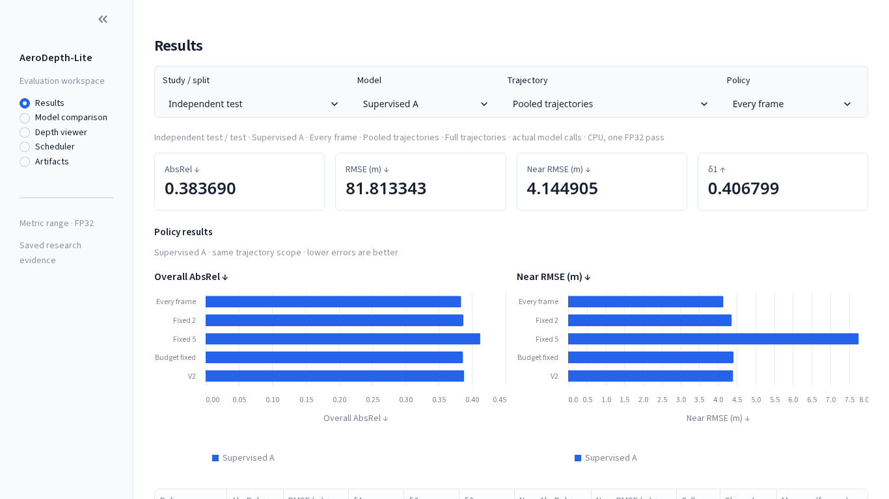

# AeroDepth-Lite

Compact monocular drone-camera **range prediction** with causal inference scheduling. A MobileNetV3-Small encoder and skip decoder predict a 192 × 320 map of Euclidean camera range in metres. The V2 scheduler decides when to compute a fresh map or reuse the previous one.

The project includes inference weights for **Original, supervised A, exploratory KD and the ResNet-50 teacher**, a local research dashboard, automated software tests and saved experimental evidence. Training and the **8,820-frame independent test are complete and verified**. This is simulation research; real-flight safety, energy and battery benefits have not been measured.

[Project report](docs/FINAL_REPORT.md) · [Documentation](docs/README.md) · [Repository structure](docs/repository_structure.md)

## Install and run

For a fresh CPU environment, use Python 3.13 from the repository root:

```bash
python3.13 -m venv .venv
. .venv/bin/activate
python -m pip install --upgrade pip
python -m pip install torch==2.14.1 torchvision==0.29.1 --index-url https://download.pytorch.org/whl/cpu
python -m pip install -e '.[dev,midair,dashboard]' -c requirements-tested.txt
python -m streamlit run scripts/dashboard.py
```

On the prepared laptop, activate the existing `.venv` and run the final command. Keep an existing compatible CUDA environment for GPU use; see [installation](docs/installation.md).

The dashboard has Results, Model comparison, Depth viewer, Scheduler and Artifacts pages. It opens on the independent study with supervised **A epoch 9** preselected. Saved tables and curves work without a dataset. All four inference models are included. ResNet-50 appears in Results and Model comparison only when **Validation** is selected, with its failed-gate explanation. The depth viewer supports the three students. Validation images and recorded playback need separately configured data/cache inputs; missing inputs appear as unavailable. See [dashboard instructions](docs/presentation_dashboard.md).



## Predict range from an image

The A export runs without MidAir, private checkpoints or an ImageNet download:

```bash
aerodepth infer \
  --weights models/presentation_A_epoch9_20261029T155521Z/supervised_A_epoch9.state_dict.pt \
  --metadata models/presentation_A_epoch9_20261029T155521Z/supervised_A_epoch9.json \
  --image /path/to/image.jpg --output artifacts/prediction_A.npy --device cpu
```

For the exact evaluated KD student, use its published export:

```bash
aerodepth infer \
  --weights models/exploratory_kd_epoch9/exploratory_KD_epoch9.state_dict.pt \
  --metadata models/exploratory_kd_epoch9/exploratory_KD_epoch9.json \
  --image /path/to/image.jpg --output artifacts/prediction_KD.npy --device cpu
```

KD inference requires neither a teacher nor the original full checkpoint. Its export was verified tensor-for-tensor and by CPU FP32 output parity against the evaluated epoch-9 checkpoint. It remains exploratory with a rejected teacher. [All model exports and checksums](models/README.md). The [ResNet-50 teacher export guide](models/resnet50_teacher_epoch3/README.md) provides the equivalent command for teacher predictions on your own images.

The output is a 192 × 320 FP32 `.npy` range map in metres. RGB uses full-frame resizing and one in-model ImageNet normalization. Predictions have a 0.1 m floor and no upper clamp. The CLI defaults to the Original epoch-4 export if weight arguments are omitted. Generalization outside the simulated data is untested.

## Data and results

The custom MidAir subset contains **44,098 training frames** across 12 underlying paths, **4,410 validation frames** across two paths, and **8,820 independent-test frames** across four reserved paths. Weather variants stay grouped by underlying path. The older 4,436-frame Original-model test remains separate historical evidence. See [dataset details](docs/dataset.md).

| Study | Every-frame model | AbsRel ↓ | RMSE (m) ↓ | Near RMSE (m) ↓ |
|---|---|---:|---:|---:|
| Validation | Original epoch 4 | 0.301540 | 127.335 | 3.362 |
| Validation | Supervised A epoch 9 | 0.265831 | 119.944 | 3.906 |
| Validation | Exploratory KD epoch 9 | 0.270049 | 121.207 | 3.961 |
| Validation | ResNet-50 teacher epoch 3 | 0.240330 | 99.828 | 3.873 |
| Independent test | Original epoch 4 | 0.390815 | 81.798 | 4.087 |
| Independent test | Supervised A epoch 9 | 0.383690 | 81.813 | 4.145 |
| Independent test | Exploratory KD epoch 9 | 0.383202 | 82.174 | 4.219 |

Near field means valid ground-truth range below 10 m. A improves validation AbsRel by 11.84% versus Original, but near RMSE worsens 16.18%. On the independent test, those changes are −1.82% and +1.41%, respectively. KD slightly improves pooled test AbsRel versus A while worsening near RMSE; its validation result and rejected-teacher status remain negative. Original used a different training subset/budget; matched A/KD comparisons cover one seed. Pooled gains hide path-level regressions.

The ResNet-50 teacher improves pooled validation error, but failed its acceptance gate: on Kite, near AbsRel is 0.742757 versus A's 0.504336, and near RMSE is 6.636 m versus 4.695 m. Its 20-epoch budget differs from A's 10 epochs. ResNet-50 was not evaluated in the independent test; the dashboard displays no test scores for it.

On the independent test, **V2 uses 3,718 calls versus 4,912 for budget-fixed**, with 17.08% lower measured inference-plus-scheduler time. AbsRel worsens 0.43%, near RMSE improves 0.25%, and maximum event-update delay rises from 1 to 4 frames. This one CPU pass excludes shared I/O/decode and offline scoring; it is not an end-to-end speed or energy claim. [Complete results and limitations](docs/FINAL_REPORT.md).

## Verify and reproduce

Run software checks without MidAir:

```bash
PYTHONDONTWRITEBYTECODE=1 OMP_NUM_THREADS=2 MKL_NUM_THREADS=2 \
  python -B -m pytest -q -p no:cacheprovider -m 'not integration'
```

Audit the completed independent study without reading test images or running inference:

```bash
python scripts/verify_independent_test.py
```

For a dataset-free synthetic workflow, run `python scripts/smoke.py --output artifacts/new_synthetic_smoke`. Synthetic fixtures verify software, not research accuracy.

Use the [original validation reproduction guide](docs/reproduction.md), [expanded training guide](docs/expanded_reproduction.md) and [independent-study guide](docs/independent_final_test.md) for their separate input requirements and source revisions. Historical checkpoint resume requires matching frozen source identities.

## Repository contents

| Path | Purpose |
|---|---|
| `src/aerodepth_lite/` | Python implementation: models, data, training, inference, scheduling and dashboard helpers |
| `scripts/` | Supported dashboard, training, reproduction and verification entry points |
| `tests/` | Automated checks using synthetic inputs and saved evidence; optional real-data integration checks |
| `configs/` | Portable dashboard and experiment settings |
| `models/` | Three student exports plus the ResNet-50 teacher export, with metadata and checksums |
| `results/`, `evidence/` | Curated scientific results, manifests, protocols and provenance |
| `docs/` | User guides, methodology, evaluation report and reproduction instructions |

Dataset attribution and upstream terms: [NOTICE.md](NOTICE.md).
