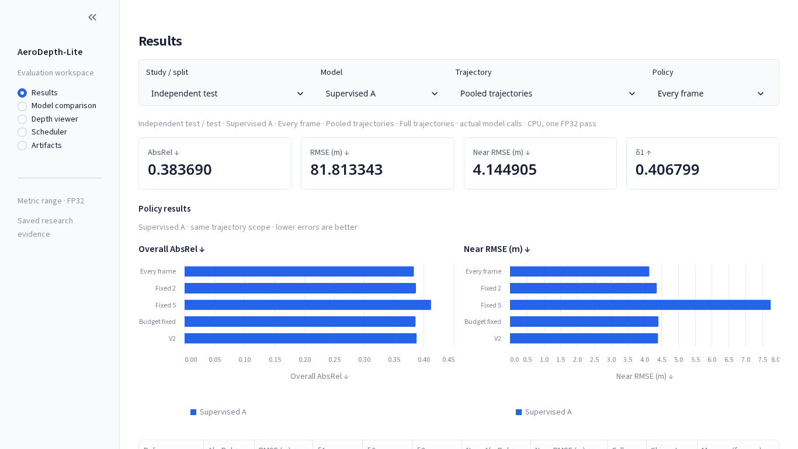
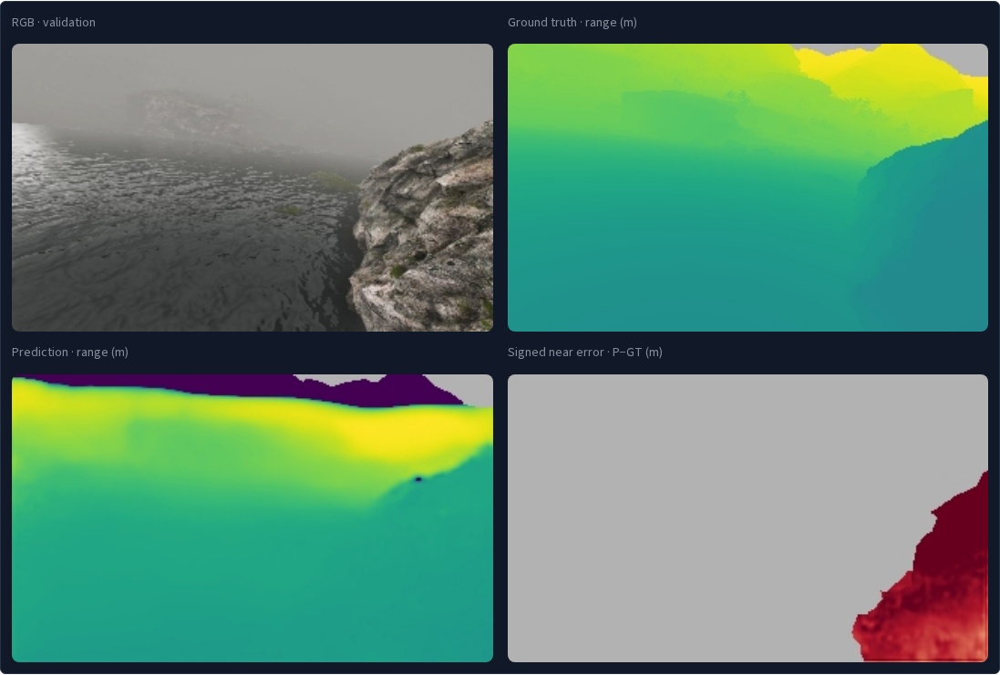

# Research application redesign · 1 November 2026

The existing Streamlit application now uses compact sidebar navigation, shared context controls, neutral light surfaces and a dark 2×2 image workspace. The promotional header, gradient cards, model emojis and primary-flow JSON dumps are removed. Streamlit, the existing Python/PyTorch installation, guarded inference helpers and all frozen scientific evidence are retained.

| View | Rendered screenshot |
|---|---|
| Results · independent test, A, every frame, pooled | [Desktop](results_desktop.png) · [Mobile](results_mobile.png) |
| Model comparison · independent Kite sunny, named baseline | [Desktop](comparison_desktop.png) |
| Validation viewer and controls | [Desktop](viewer_desktop.png) · [Mobile](viewer_mobile.png) |
| Full 2×2 validation image canvas | [Image panels](viewer_canvas.png) |
| Scheduler · independent A V2 | [Desktop](scheduler_desktop.png) |
| Previous presentation UI | [Before](before_desktop.png) |





MidAir validation imagery: Fonder & Van Droogenbroeck, CC BY-NC-SA 4.0; [attribution and terms](../../NOTICE.md). No test imagery is used in these screenshots.

## Implementation

- `scripts/dashboard.py`: configuration, sidebar navigation and page routing.
- `src/aerodepth_lite/dashboard_data.py`: read-only display projections, file-identity caches, supported model/policy/trajectory combinations and saved validation examples.
- `src/aerodepth_lite/dashboard_views.py`: Results, comparison, viewer, scheduler and artifact rendering with native controls and Altair plots.
- `src/aerodepth_lite/dashboard_style.py` and `.streamlit/config.toml`: restrained application theme and image-canvas styling.
- `src/aerodepth_lite/presentation_ui.py`: existing artifact verification, validation guards and inference functions, unchanged.

The display adapter checks exact authoritative values and retains missing fields as unavailable. Its independent-result cache invalidates when any bound artifact's file identity changes. Model comparison explicitly uses every-frame policies; historical results support Original only. Validation scheduler quality and separate 256-frame repeated timing stay labelled independently. Stable model colours are slate / blue / amber. Relative changes are descriptive and name the reference.

## Verification

**Local tests:** 135 passed, four optional tests skipped and one real-data integration test excluded; 14 nonfatal warnings (13 external Streamlit/Pandas deprecations and one intentional duplicate-ZIP fixture). New adapter tests are under `tests/dashboard/` so optional display-only cases do not expand the compact Kaggle training bundle. Existing packaging/setup tests still pass; training packaging and scientific source were not changed.

**Actual browser:** isolated Chromium at 1366×768 and 390×844; [complete browser receipt](browser_verification.json). The canvas was additionally captured at the same desktop width with a taller viewport to show all four full-size panels. Checks exercised:

- Default independent test and all three rounded pooled metric anchors, loaded from exact saved records.
- Validation / independent / historical separation, per-trajectory comparison and explicitly named reference model.
- Full-path calls/quality, V2 versus unequal budget-fixed calls, zero-event undefined delay, aligned timelines and validation timing-window labels.
- Three real guarded FP32 CPU validation forwards (A, Original, KD), each with unchanged parameters and BatchNorm state.
- Recorded A V2 replay, changing current/source frames, frame seeking/presets and image download.
- Selected CSV values, exact report/figure download hashes, model metadata context and mobile document overflow.
- Native keyboard navigation/focus, mobile title clearance and four preserved 320:192 image aspect ratios.

The configured rescue USB was connected during verification. Portable/missing-input tests also checked unavailable datasets/caches and a missing private KD checkpoint: recorded evidence remains available where present, and actual inference is disabled. No new test images were decoded, no scientific evaluation or training was run, and no personal browser profile/history was used.

[Scientific preservation and local verification receipt](verification.json) records the unchanged protected files, frozen-study audit and final source identities. CI is manual-only in this repository. **Local test success is not a claim that CI ran or passed.**

## Launch and limits

Current local URL: **http://127.0.0.1:8501**. The existing `aerodepth-dashboard-20261029t155521z.service` is reused, without a second server. Start that unit while present, or use the existing manual launch command when no service is running:

```bash
python -m streamlit run scripts/dashboard.py
```

See [the dashboard guide](../presentation_dashboard.md) for service commands, portable configuration and explicit external inputs.

Saved result pages work without the USB; full validation replay and raw-frame inference require the configured healthy external files. KD's selected checkpoint remains private. No additional pixel inspector, confidence estimates, telemetry or missing signal values are invented. Single-pass CPU timings and repeated CPU/CUDA validation windows are separate evidence. No energy, battery, flight-safety or significance claim follows from this UI refactor.

[MLflow Tracking](https://mlflow.org/docs/latest/tracking/), [Foxglove Image](https://docs.foxglove.dev/docs/visualization/panels/image), [Plot](https://docs.foxglove.dev/docs/visualization/panels/plot), [Playback](https://docs.foxglove.dev/docs/visualization/playback), and [shadcn dashboard](https://ui.shadcn.com/examples/dashboard) informed the table, image/timeline and navigation patterns; no referenced service was installed.
