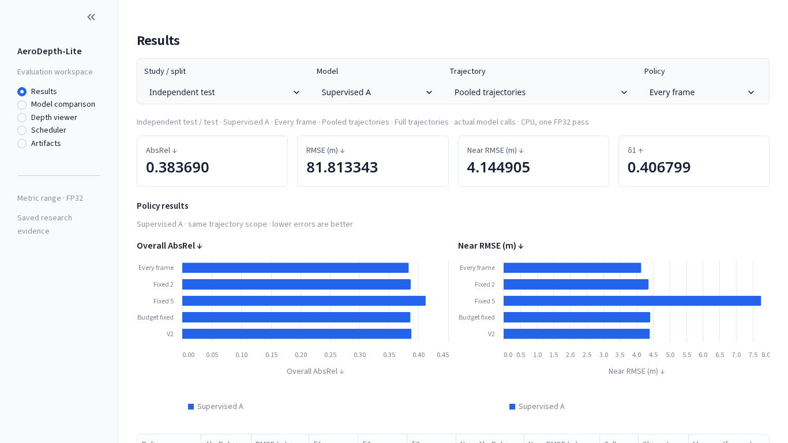
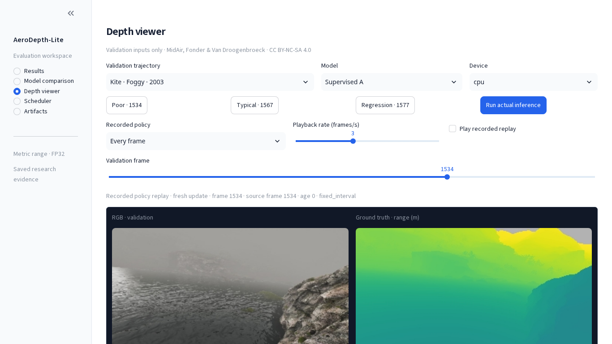

# AeroDepth-Lite research application

The Streamlit app has five pages: **Results**, **Model comparison**, **Depth viewer**, **Scheduler**, and **Artifacts**. It opens on the completed independent test, supervised A, every-frame policy and pooled trajectories. A remains the preselected general-depth model; Original is the near-field reference; Exploratory KD keeps its exploratory designation. All numbers come from existing saved evidence. The UI does not train, tune, evaluate test images or rerun studies.



## Start the application

From the repository root:

```bash
. .venv/bin/activate
python -m pip install -e '.[dashboard]'
python -m streamlit run scripts/dashboard.py
```

Open **http://127.0.0.1:8501**. Use one running instance on that port. The application binds to localhost, disables usage statistics, and works offline after installation. The normal inference CLI does not import Streamlit or UI modules.

## Context and data

Results, Model comparison and Scheduler share study/split, model and trajectory selection. Results and Scheduler also select policy. Model comparison explicitly supports every-frame comparisons; its policy control is disabled and shows that supported context. Validation scheduler traces support A; the historical exposed test supports Original only. Unsupported selections are visibly constrained, rather than carrying stale metrics into a new context. The depth viewer explicitly uses validation inputs regardless of the selected evaluation study.

Every context caption identifies the study, split, model/policy, trajectory and measurement scope. Missing or undefined quantities appear as unavailable or `—`; zero-event delays are never displayed as zero. Reference differences name the comparator and are descriptive, not statistical significance claims.

| Study | Evidence | Scope |
|---|---|---|
| Independent test | `results/independent_test_20261030/` | 8,820 frames, four reserved paths, seven completed comparisons; actual CPU calls, one timing pass |
| Validation | `results/student_validation_comparison_20261029T152648Z/` and `results/presentation_validation_20261029T155521Z/` | 4,410-frame model metrics and causal quality replay; separate measured 256-frame CPU/CUDA windows, three repetitions |
| Historical exposed test | `results/final_test/` | Original model, 4,436 frames, preserved historical execution; no A/KD evaluation |

Small artifact reads and parsed CSVs are cached by file modification identity. Independent-study integrity checks reuse the existing verified loader and are cached only while all bound artifact identities remain unchanged. Frame arrays are read from existing memory maps. No new prediction cache or result substitution is created.

## Pages

**Results** gives the selected numeric summary, policy comparison table, and separate overall AbsRel/near-RMSE plots. Status and limitations are in a collapsed contextual panel. Original uses slate, A blue and KD amber consistently. Tables retain sortable native columns and explicit metric units/directions.

**Model comparison** shows all supported models for the selected split and trajectory, paired overall/near plots and signed relative differences against a named reference. Training histories are inside an expander labelled validation evidence, including the original precision/budget caveats. KD's slightly lower independent pooled AbsRel does not erase its worse near RMSE or its negative validation comparison.

**Depth viewer** keeps a large 2×2 RGB/GT/prediction/signed-near-error layout on a dark canvas. Controls select validation trajectory, model, device, preset/frame and recorded policy. Input aspect ratios and common log-range/error scales are preserved. Images are attributed to MidAir (Fonder & Van Droogenbroeck, CC BY-NC-SA 4.0); see [NOTICE](../NOTICE.md).



Actual FP32/eval inference occurs only after **Run actual inference**. Existing weight hashes, validation allowlists, read guards and parameter/BatchNorm-state checks remain unchanged. The observation table describes one call, not a benchmark. Changing model/frame/device cannot reuse an old call as a fresh result. The selected frame survives leaving and returning to the viewer; playback returns paused. Recorded policy replay shows current frame, source frame, reason and prediction age; playback frames/s is a display setting. The image download saves the displayed colourized validation prediction, not raw scientific range data.

Full replay needs the existing validation cache. Original/KD have six fixed recorded examples; other frames require explicit inference. Without the full cache, those existing examples can still be shown when their private arrays are present, with continuous replay disabled. No pixel inspection, telemetry, uncertainty or confidence values are invented.

**Scheduler** aligns fresh-inference events, prediction age and any recorded motion/visual/risk/score signals on one frame axis. The frame window and inspector use trajectory-local indices. Offline GT events are clearly labelled. Independent traces do not contain recorded signal values, so only available events/ages are plotted. Undefined event statistics, terminal censoring and quality remain visible alongside calls/skip/age.

The timing inspector keeps full-trajectory quality separate from 256-frame validation windows. Single-pass independent CPU compute is not combined with repeated validation CPU/CUDA timing. Equal-call wording is derived from actual counts in the chosen quality scope; independent V2 and budget-fixed have different call budgets. No energy, battery or flight-safety benefit is inferred.

**Artifacts** groups reports, selected-study tables, figures, protocols and inference metadata with readable download names. Full identities/configuration are in a technical inspector. Historical V1/V2 scheduler archives remain separately labelled Original-only evidence.

## Portable configuration and external inputs

The laptop retains ignored `configs/presentation_local.json`; relocated checkouts use `configs/presentation.json`. Override explicitly:

```bash
AERODEPTH_PRESENTATION_CONFIG=/absolute/path/to/prepared_config.json \
  python -m streamlit run scripts/dashboard.py
```

Public artifact/export paths are relative to the checkout. Optional external locations require explicit environment variables:

```bash
export MIDAIR_ROOT=/your/healthy/verified/MidAir
export AERODEPTH_PRESENTATION_CACHE=/your/private/validation-cache
export AERODEPTH_COMPARISON_CACHE=/your/private/fixed-example-arrays
export AERODEPTH_KD_CHECKPOINT=/your/private/verified/KD-best.pt
```

Unset inputs resolve to an unavailable location. Saved result pages work without datasets or private KD weights. The UI never scans for arbitrary datasets. The failed HDD is not an input source. [Independent-study requirements](independent_final_test.md) and [expanded reproduction](expanded_reproduction.md) describe full-data research reproduction; these are separate from using the UI. Do not rerun completed scientific workflows to refresh screenshots.

## Software verification

The `tests/` directory checks saved-data adapters, context selection, viewer state and inference guards. Run the dataset-free checks in the project README. Study/source identities and saved metrics remain unchanged by UI or documentation maintenance; a displayed playback rate is not measured inference throughput.

## Classroom sequence

1. Results: independent test → A → every frame → pooled; read actual numeric errors.
2. Model comparison: compare Original/A/KD, choose a reference, then inspect Kite sunny and validation separately.
3. Depth viewer: use the Poor/Typical validation presets, explicitly run one model, then play recorded A V2 and inspect source/age.
4. Scheduler: compare independent V2 with budget-fixed, then view the zero-event sunny trajectory and separately labelled validation timing windows.
5. Artifacts: download the table/report and open the protocol/identity inspector if needed. Use the [viva guide](VIVA_GUIDE.md) to locate the underlying model, loss, metrics and guards.
